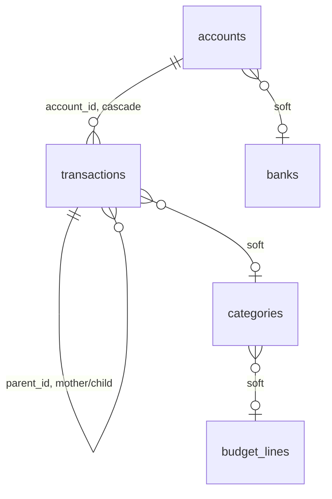

# Data model

One SQLite file per database, created and migrated by
`core/src/db/schema.rs`. This document covers what's implemented today; see
`PROMPT.md` for the tables planned for features not built yet (cheques,
recurring rules, budget, attachments).

## Rules that aren't visible in the DDL

1. **Amounts are `i64` micro-units.** A value times 1,000,000: `12.34`
   is stored as `12_340_000`. See `core::money::Amount`. No floating point
   ever touches money.
2. **A transaction's `amount` sign is the only signal**: negative is a
   debit, positive is a credit. No separate debit/credit columns.
3. **Soft links, not foreign keys, for reference lists.** `category_id`,
   `payee_id`, `payment_mode_id`, `tag_id`, `project_id`, `bank_id`, and
   `categories.budget_line_id` are plain integers, `0` meaning
   "unspecified". Deleting a reference-list entry reassigns every row that
   pointed at it back to `0` (see `reference_lists::delete`); it never
   cascades into transactions or accounts.
4. **Two-level transaction tree.** `transactions.parent_id` is `0` for a
   top-level transaction, or the parent's id for a split line. **Only
   `parent_id = 0` rows count** toward a balance or a total -
   `accounts::recompute_balances` and `transactions::list_for_account` both
   filter on it. Counting a child too would count the same money twice.
5. **The remainder line.** A split's last child (`is_remainder = 1`) holds
   `parent.amount - sum(explicit children)`, recomputed by
   `transactions::sync_remainder` after every split-line change. It's
   recognised by the flag, never by its (deliberately empty) label - the UI
   substitutes its own translated placeholder.
6. **Three balances per account, always recomputed whole.**
   `balance_cleared` / `balance_committed` / `balance_projected` are never
   patched in place; `accounts::recompute_balances` rebuilds all three (plus
   every transaction's `running_balance`) from the account's opening
   balances and its current transactions, every time a top-level transaction
   changes.
7. **A closed account (`is_closed = 1`) is excluded from `accounts::list`
   by default** and from `accounts::total_projected_balance` - it no longer
   represents money the household can spend.

## Tables

### `accounts`

One row per bank account. `opening_balance_*` is what the account held
*before* the first transaction it knows about; `balance_*` is the current
cumulative balance, cleared ⊆ committed ⊆ projected.

### `transactions`

The largest table. `status` is `1` cleared / `2` committed / `3` planned - a
closed list relied on throughout `core`. `external_id` is reserved for a
bank's unique transaction id (OFX `FitID`), for reconciliation once import
lands.

### Reference lists

`payees`, `payment_modes`, `tags`, `projects`, `budget_lines`, `banks`: `id`
+ unique `name`. `categories` is the same shape plus `budget_line_id`. All
seven go through `core::reference_lists` for create/list/rename/delete.

## Migrations

`db::schema::migrate` runs `CREATE TABLE IF NOT EXISTS` for the whole schema
on every open - idempotent, no version tracking yet. Once the schema needs
to change under existing data, this is where a `PRAGMA user_version`-based
migration chain belongs (see the note in `schema.rs`).
